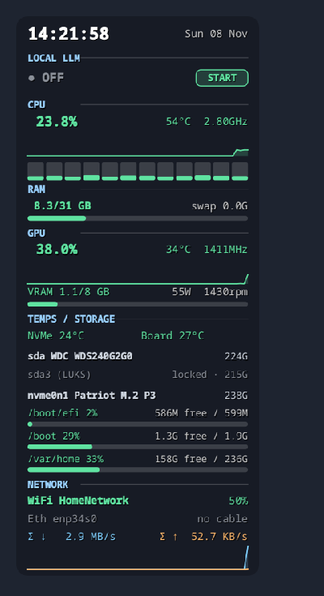

# sysmon-widget

Transparent, draggable desktop system monitor (PySide6 + psutil) for Linux.
Shows CPU (per-core), RAM/swap, GPU (AMD amdgpu: load, VRAM, temp, power, fan),
temps (k10temp, NVMe, Super-I/O), disks (incl. locked LUKS), Ethernet/WiFi, network graph.

## Features
- Clock, CPU total + per-core bars + history graph, frequency, temp
- RAM / swap, GPU load / VRAM / temp / power / fan (AMD)
- NVMe and motherboard temps, per-disk and per-mount usage, locked LUKS volumes shown
- WiFi SSID + signal (via `nmcli`), Ethernet link/speed/IP, aggregate up/down graph
- Optional local-LLM start/stop button

## Requirements
- Linux, Python >= 3.9, a desktop session (X11 or Wayland)
- `psutil`, `PySide6` (installed automatically)
- Optional: `nmcli` (WiFi info), `lsblk` (disks), `systemctl --user` (LLM button)

## Install

    git clone https://github.com/kranmal/sysmon-widget && cd sysmon-widget
    ./install.sh        # or: pipx install .

## Usage
Run `sysmon`. Left-drag to move, right-click for opacity / click-through / quit.

Autostart: copy `data/sysmon.desktop` to `~/.config/autostart/`.

Uninstall: `pipx uninstall sysmon-widget` and remove `~/.local/share/applications/sysmon.desktop`.

## Notes
- GPU panel needs the `amdgpu` driver sysfs; sensors that are missing are skipped.
- Needs `lsblk` (util-linux) for the disk panel.
- Includes a START/STOP button for a `llama-server` systemd **user** unit
  (`~/.config/systemd/user/llama-server.service`, health at `127.0.0.1:8080`). Ignore if unused.
- Wayland: always-on-bottom depends on compositor; works best on X11/XWayland.

MIT licensed.
